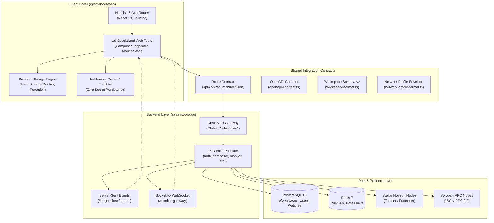

# Architecture Map: Web Tools, API Modules & Shared Contracts

This document establishes the official architecture map across the SaviTools
system, detailing how client-side web tools, NestJS backend API modules, and
shared integration contracts interconnect.

---

## 1. System Topology & Architectural Layers

SaviTools is built as a modular monorepo partitioned into two primary packages:
`@savitools/web` (the developer console frontend) and `@savitools/api` (the backend
service tier).



---

## 2. Web Tools to API Modules Mapping Matrix

The following matrix documents each of the **19 web tools** in `@savitools/web`,
identifying the backend modules they consume, their primary endpoints, and
the contracts that govern their integration:

| Tool Route                    | Tool Name             | API Modules                                            | Primary Endpoints                                                                                               | Shared Contracts                                  | Protocol / External Dependencies     |
| ----------------------------- | --------------------- | ------------------------------------------------------ | --------------------------------------------------------------------------------------------------------------- | ------------------------------------------------- | ------------------------------------ |
| `/inspector`                  | Transaction Inspector | `inspector`, `transaction`, `stellar`                  | `POST /api/v1/inspector/decode`<br/>`POST /api/v1/transaction/analyze`                                          | RouteContract, OpenApiContract                    | Stellar Horizon, XDR Decoder         |
| `/composer`                   | Transaction Composer  | `composer`, `workspace`, `stellar`, `sequence-planner` | `GET/POST /api/v1/composer/workspaces`<br/>`POST /api/v1/composer/estimate-fee`<br/>`GET /api/v1/workspaces`    | WorkspaceFormatV2, RouteContract, OpenApiContract | Stellar Horizon, Soroban RPC         |
| `/sandbox`                    | Sandbox               | `sandbox`, `wallet`, `stellar`                         | `POST /api/v1/sandbox/keypair`<br/>`POST /api/v1/sandbox/fund`                                                  | RouteContract, OpenApiContract                    | Stellar Friendbot, ED25519           |
| `/sandbox/assetcontrol`       | Asset Control         | `sandbox`, `wallet`, `stellar`                         | `GET /api/v1/wallet/trustlines`<br/>`GET /api/v1/stellar/asset-flags`                                           | RouteContract, OpenApiContract                    | Stellar Horizon, Flag Assembler      |
| `/simulator`                  | Simulator             | `simulator`, `liquidity-pools`, `stellar`              | `POST /api/v1/simulator/paths`<br/>`POST /api/v1/simulator/estimate-fee`                                        | RouteContract, OpenApiContract                    | Stellar DEX, Path Finding API        |
| `/playground`                 | API Playground        | `playground`, `auth`, `sdkgen`                         | `POST /api/v1/playground/proxy`<br/>`GET /api/v1/playground/schema`                                             | OpenApiContract, RouteContract                    | OpenAPI 3.0 Document                 |
| `/webhooks`                   | Webhooks              | `webhook`                                              | `GET /api/v1/webhooks/deliveries`<br/>`POST /api/v1/webhooks/test-payload`<br/>`POST /api/v1/webhooks/verify`   | RouteContract, OpenApiContract                    | HMAC-SHA256 WebCrypto                |
| `/contracts`                  | Smart Contracts       | `contracts`, `soroban-rpc`, `soroban-storage`          | `POST /api/v1/contracts/deploy`<br/>`GET /api/v1/contracts/inspect`<br/>`POST /api/v1/soroban-rpc/simulate`     | RouteContract, OpenApiContract                    | Soroban RPC, Stellar.Expert Explorer |
| `/monitor`                    | Ledger Monitor        | `monitor`, `ledger-close`                              | `GET/POST /api/v1/monitor/watches`<br/>`GET /api/v1/monitor/stream`<br/>`GET /api/v1/ledger-close/stream`       | RouteContract, OpenApiContract                    | Server-Sent Events, Socket.IO        |
| `/inspector/federation`       | Federation & TOML     | `federation`, `stellar-toml`                           | `GET /api/v1/federation/resolve`<br/>`GET /api/v1/stellar-toml/fetch`<br/>`POST /api/v1/stellar-toml/sep-check` | RouteContract, OpenApiContract                    | SEP-0002, SEP-0001 (stellar.toml)    |
| `/simulator/orderbook`        | Order Book            | `simulator`, `liquidity-pools`                         | `GET /api/v1/simulator/orderbook`<br/>`GET /api/v1/liquidity-pools/list`                                        | RouteContract, OpenApiContract                    | Stellar Horizon DEX Orderbook        |
| `/simulator/path-payment-lab` | Slippage Lab          | `simulator`                                            | `POST /api/v1/simulator/slippage-analysis`<br/>`POST /api/v1/simulator/paths`                                   | RouteContract, OpenApiContract                    | Stellar DEX Paths                    |
| `/multisig`                   | Multisig Simulator    | `multisig`, `wallet`, `stellar`                        | `POST /api/v1/multisig/verify`<br/>`GET /api/v1/multisig/signers`                                               | RouteContract, OpenApiContract                    | Stellar Horizon Account Signers      |
| `/inspector/graph`            | Account Graph         | `transaction`, `inspector`                             | `POST /api/v1/transaction/graph`<br/>`GET /api/v1/inspector/account-relations`                                  | RouteContract, OpenApiContract                    | D3 Force-Directed Layout, Horizon    |
| `/contracts/events`           | Contract Events       | `contracts`, `soroban-rpc`                             | `GET /api/v1/contracts/events`<br/>`POST /api/v1/soroban-rpc/getEvents`                                         | RouteContract, OpenApiContract                    | Soroban RPC getEvents, ScVal XDR     |
| `/sdk`                        | SDK Generator         | `sdkgen`, `playground`                                 | `POST /api/v1/sdk/generate`<br/>`GET /api/v1/playground/schema`                                                 | OpenApiContract, RouteContract                    | OpenAPI 3.0 Codegen Engine           |
| `/network`                    | Network Status        | `network`, `ledger-close`                              | `GET /api/v1/network/status`<br/>`GET /api/v1/ledger-close/stats`<br/>`GET /api/v1/network/fee-stats`           | NetworkProfileFormatV1, RouteContract             | Horizon Network Metrics, Soroban     |
| `/rpc`                        | Soroban RPC           | `soroban-rpc`, `soroban-storage`                       | `POST /api/v1/soroban-rpc/execute`<br/>`GET /api/v1/soroban-storage/entry`                                      | RouteContract, OpenApiContract                    | Soroban JSON-RPC v2                  |
| `/qr-handoff`                 | QR Handoff            | `transaction`, `wallet`                                | `POST /api/v1/transaction/xdr-verify`                                                                           | RouteContract                                     | jsQR, QRCode, Checksummed Frames     |

---

## 3. API Modules Catalog & Responsibilities

The `@savitools/api` application organizes business logic into **26 NestJS modules**:

| Module Name        | Domain & Scope                                                      | Persistence                           | External Protocols               |
| ------------------ | ------------------------------------------------------------------- | ------------------------------------- | -------------------------------- |
| `auth`             | User sessions, API keys, WebAuthn passkeys, vault secrets           | PostgreSQL (users, keys, credentials) | Passkey / WebAuthn, JWT          |
| `composer`         | Multi-op transaction builder & template storage                     | PostgreSQL (composer_workspaces)      | Stellar Horizon, Soroban RPC     |
| `contracts`        | Soroban contract deployment, verification, ABI catalog              | PostgreSQL (contract_deployments)     | Soroban RPC, WASM bytecode       |
| `federation`       | Stellar federation resolution (SEP-0002)                            | Stateless                             | Reverse DNS, HTTP SEP-0002       |
| `inspector`        | Low-level XDR inspection, operation parsing, balance diffs          | Stateless                             | Stellar Horizon, XDR             |
| `ledger-close`     | Ledger close tracking, interval calculations, health metrics        | Redis (close intervals buffer)        | Stellar Horizon SSE stream       |
| `liquidity-pools`  | DEX liquidity pool tracking, reserve calculations, share accounting | Stateless                             | Stellar Horizon AMM endpoints    |
| `metrics`          | Prometheus metrics endpoint (`GET /metrics`)                        | In-memory counters / gauges           | Prometheus scrape format         |
| `monitor`          | Real-time address and contract event tracking                       | PostgreSQL (watches) + Redis pub/sub  | Server-Sent Events, Socket.IO    |
| `multisig`         | Signature threshold verification and missing signers analysis       | Stateless                             | Horizon Account Signers, ED25519 |
| `network`          | Network status, fee statistics, custom network profile management   | Stateless                             | Stellar Horizon, Soroban RPC     |
| `playground`       | Proxy execution for Fluxa and CrowdPay interactive API testing      | Stateless                             | HTTP client proxy, OpenAPI 3.0   |
| `sandbox`          | Testnet keypair generation, Friendbot account funding               | Stateless                             | Stellar Friendbot API            |
| `sdkgen`           | Client SDK generator (TypeScript, Python, Go, cURL)                 | Stateless                             | OpenAPI 3.0 AST Parser           |
| `sep10`            | Stellar Web Authentication challenge verification                   | Stateless                             | SEP-0010 Challenge Transaction   |
| `sep24`            | Hosted interactive deposit/withdrawal debugging                     | Stateless                             | SEP-0024, SEP-0006 Anchor APIs   |
| `sequence-planner` | Sequence number allocation and multi-transaction queuing            | Stateless                             | Stellar Horizon Account Sequence |
| `simulator`        | Payment path discovery, fee estimation, DEX orderbook depth         | Stateless                             | Horizon Path Finding, DEX Engine |
| `soroban-rpc`      | Read-only Soroban JSON-RPC method dispatch and simulation           | Stateless                             | Soroban JSON-RPC v2              |
| `soroban-storage`  | Contract instance and persistent state TTL inspection               | Stateless                             | Soroban RPC getLedgerEntries     |
| `stellar`          | Core Horizon client factory, network passphrases, retry policies    | Stateless                             | Stellar Horizon API              |
| `stellar-toml`     | Domain discovery, `stellar.toml` parsing, SEP compliance checks     | Stateless                             | SEP-0001 Discovery               |
| `transaction`      | Transaction submission, dependency graph generator, replay logic    | PostgreSQL (replay_events)            | Stellar Horizon, XDR             |
| `wallet`           | Balance checks, asset trustline queries, Freighter detection        | Stateless                             | Stellar Horizon Account Balances |
| `webhook`          | Endpoint registration, test delivery, HMAC signature verification   | PostgreSQL (webhook_deliveries)       | HTTP POST Webhooks, HMAC-SHA256  |
| `workspace`        | Standard workspace file serialization and server sharing            | PostgreSQL (shared_workspaces)        | JSON Schema v2                   |

---

## 4. Shared Integration Contracts

To prevent frontend and backend divergence, SaviTools enforces **five explicit contract gates**:

### 4.1 Route Contract (`api-contract.ts` & `api-contract.manifest.json`)

- **Location**: `apps/api/src/contracts/`
- **Enforcement**: Continuous integration gate (`Route Contract (API <-> Web)`).
- **Mechanism**: Reads live NestJS controller decorators at compile-time and
  verifies that every route matches the committed manifest. The frontend client
  (`apps/web/src/lib/api.ts`) is cross-tested against this manifest to ensure
  no dead or mismatched endpoints exist.

### 4.2 OpenAPI Contract Gate (`openapi-contract.ts` & `openapi-fixtures.ts`)

- **Location**: `apps/api/src/contracts/`
- **Enforcement**: CI gate (`OpenAPI Contract (routes + fixtures)`).
- **Mechanism**: Inspects Swagger metadata on all controllers and validates
  representative success and validation-error fixtures for every public module.
  Ensures the generated OpenAPI document perfectly mirrors runtime behavior.

### 4.3 Workspace Interchange Schema (`workspace-format.ts`)

- **Location**: `apps/web/src/lib/workspace-format.ts`
- **Contract Version**: `formatVersion: 2`
- **Compatibility**: Automatically detects and migrates legacy unversioned (`v0`)
  and explicit `v1` workspace files to `v2` during import, preserving user data
  across client upgrades.
- **Export Sanitization**: All exported and shared workspace payloads are automatically
  sanitized prior to export via `workspace-sanitizer` and `workspace-format.ts`.
  Stellar secret seeds (`S...`), private credentials, bearer/JWT tokens, and signed
  transaction envelopes / signatures are stripped to prevent credential exposure
  and replay attacks.

### 4.4 Network Profile Envelope Contract (`network-profile-format.ts`)

- **Location**: `apps/web/src/lib/network-profile-format.ts`
- **Contract Version**: `version: 1`
- **Compatibility**: Encapsulates custom Horizon URLs, Soroban RPC endpoints,
  and network passphrases. Safely parses both bare legacy arrays (`v0`) and
  versioned envelopes (`v1`).

### 4.5 Standard Error Envelope Taxonomy

All API error responses implement a uniform structure:

```json
{
  "statusCode": 400,
  "error": "Bad Request",
  "message": "Detailed actionable error message",
  "timestamp": "2026-10-21T21:00:00.000Z",
  "path": "/api/v1/simulator/paths"
}
```

---

## 5. Security & Operational Boundaries

1. **Air-Gapped Key Isolation**:
   Private keys and secret seeds (`S...`) are processed exclusively client-side
   in ephemeral browser memory. The API tier never handles secret keys.
2. **Testnet Locking**:
   All execution modules are hard-locked to Testnet, Futurenet, and local
   sandbox networks. Mainnet submission is rejected at both UI and API levels.
3. **Storage & Quota Defenses**:
   Client storage is guarded by `browser-storage.ts`, catching `QuotaExceededError`
   and bounding historical arrays to protect user sessions.
