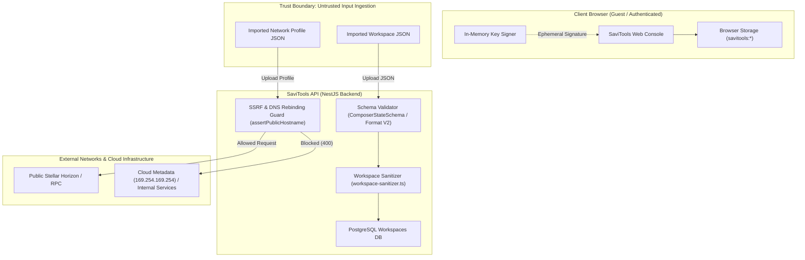

# Threat Model: Shareable Workspaces & Imported Network Profiles

This document provides a comprehensive security threat model covering SaviTools shareable workspaces, workspace export/import routines, and imported network profiles. It applies the **STRIDE** methodology (Spoofing, Tampering, Repudiation, Information Disclosure, Denial of Service, and Elevation of Privilege) to identify trust boundaries, enumerate attack vectors, and define concrete mitigation controls implemented across the codebase.

---

## 1. Executive Summary & Architecture Scope

SaviTools enables developers and teams to inspect Stellar network states, build multi-operation transactions, and debug Soroban smart contracts. Collaboration features introduce data-exchange mechanisms across two primary surfaces:

1. **Shareable & Exported Workspaces (`/api/workspaces`, `workspace-storage.ts`, `workspace-format.ts`)**:
   - Workspaces allow users to construct transaction payloads, save form state, and export them as portable JSON files or generate bearer share links (`/shared/composer/:token`).
   - _Primary Security Risks_: Secret leakage (private keys/seeds `S...`), signed transaction replay, cross-tenant data exposure, malformed JSON ingestion.

2. **Imported Network Profiles (`/api/network`, `network.service.ts`, `network-profile-format.ts`)**:
   - Allows users to specify custom Horizon RPC endpoints, network passphrases, and friendbots.
   - _Primary Security Risks_: Server-Side Request Forgery (SSRF) targeting internal VPC resources or cloud metadata (`169.254.169.254`), DNS rebinding, unauthenticated loopback access, protocol smuggling.

---

## 2. Trust Boundaries & Data Flow Diagram

---

## 3. STRIDE Threat Analysis

### 3.1 Shareable Workspaces

| STRIDE Category            | Threat Description                                                                           | Attack Vector / Scenario                                                                        |   Severity   | Mitigation Controls Implemented                                                                                                                                                                                                   |
| :------------------------- | :------------------------------------------------------------------------------------------- | :---------------------------------------------------------------------------------------------- | :----------: | :-------------------------------------------------------------------------------------------------------------------------------------------------------------------------------------------------------------------------------- |
| **Spoofing**               | Attacker impersonates legitimate workspace owner or creates malicious share links.           | Guessing workspace share tokens or forging bearer links.                                        |  **Medium**  | Cryptographically secure 192-bit bearer tokens (`crypto.randomBytes(24).toString('hex')`) with bounded 7-day expiration (`shareExpiresAt`).                                                                                       |
| **Tampering**              | Modification of workspace JSON to corrupt state or inject malicious transaction operations.  | Crafting malformed JSON payloads or schema version mismatch.                                    |   **High**   | Strict schema validation (`ComposerStateSchema.validate` and `migrateWorkspaceFile`) enforcing `WORKSPACE_FORMAT_VERSION = 2`. Unsupported versions fail deterministically.                                                       |
| **Repudiation**            | An attacker claims a transaction payload was altered on the server.                          | Untracked modifications to shared workspace states.                                             |   **Low**    | Read-only shared links prevent viewers from mutating state. Export payloads are immutable client-side snapshots.                                                                                                                  |
| **Information Disclosure** | Leakage of Stellar secret seeds (`S...`), authorization headers, or pre-signed transactions. | Exporting or sharing a composer workspace containing private key variables or signed envelopes. | **Critical** | Automated sanitization pipeline (`workspace-sanitizer.ts`) redacting secret key regex (`^S[A-Z2-7]{55}$`), sensitive key names (`secret`, `private`, `seed`), and stripping signature fields (`signedTransaction`, `signatures`). |
| **Denial of Service**      | Storage quota exhaustion or database payload explosion.                                      | Submitting arbitrarily large workspace state or cyclic JSON objects.                            |  **Medium**  | Client-side safe storage wrapper (`browser-storage.ts`) handling `QuotaExceededError`; API request body parsing capped to standard size limits.                                                                                   |
| **Elevation of Privilege** | Cross-tenant workspace hijacking.                                                            | Tampering with workspace ID query parameters to access another user's private workspace.        |   **High**   | Multi-tenant tenant scoping enforced in `findWorkspaceForUser(userId, id)` matching both `id` and `userId`.                                                                                                                       |

---

### 3.2 Imported Network Profiles

| STRIDE Category                   | Threat Description                                                                                                       | Attack Vector / Scenario                                                                    |   Severity   | Mitigation Controls Implemented                                                                                                                                              |
| :-------------------------------- | :----------------------------------------------------------------------------------------------------------------------- | :------------------------------------------------------------------------------------------ | :----------: | :--------------------------------------------------------------------------------------------------------------------------------------------------------------------------- |
| **Information Disclosure / SSRF** | Attacker uses custom `horizonUrl` to query AWS/GCP/Azure instance metadata or internal cloud services.                   | Specifying `http://169.254.169.254/latest/meta-data/` or internal Kubernetes service IPs.   | **Critical** | Multi-layer SSRF validation in `network.service.ts`: IP blacklist regex, link-local blocking, and DNS hostname resolution (`assertPublicHostname`) before outbound requests. |
| **Spoofing / DNS Rebinding**      | Attacker configures public domain that resolves to public IP on first lookup, then resolves to `127.0.0.1` upon request. | DNS rebinding attack bypassing static hostname check.                                       | **Critical** | Two-pass DNS resolution via `dns.promises.lookup` with `{ all: true }`, manual redirect verification (`redirect: 'manual'`), and validation of every redirect target hop.    |
| **Tampering**                     | Man-in-the-Middle (MITM) of horizon requests or protocol smuggling.                                                      | Specifying `gopher://`, `file://`, or cleartext `http://` on sensitive production networks. |   **High**   | Protocol enforcement restricting endpoints strictly to `http:` or `https:`. Local / loopback addresses rejected unconditionally.                                             |
| **Denial of Service**             | Slowloris or hung connection attacks on custom network probe.                                                            | Horizon endpoint that holds HTTP connections open indefinitely without sending headers.     |  **Medium**  | `AbortController` timeout bounded to 5,000ms on all probe requests; maximum redirect limit capped at 5 hops.                                                                 |

---

## 4. Verification & Testing Matrix

The security controls detailed in this threat model are backed by automated regression test suites:

| Component / Guard                    | Test File                                                     | Test Cases Covered                                                                           |
| :----------------------------------- | :------------------------------------------------------------ | :------------------------------------------------------------------------------------------- |
| **Workspace Data Sanitizer**         | `apps/api/src/modules/workspace/workspace-sanitizer.spec.ts`  | Secret key redaction, seed filtering, signature removal, clean pass-through.                 |
| **Workspace Controller & Scoping**   | `apps/api/src/modules/workspace/workspace.controller.spec.ts` | Multi-tenant user isolation, share link generation, export formatting.                       |
| **Workspace Service**                | `apps/api/src/modules/workspace/workspace.service.spec.ts`    | Share expiration, unique constraint handling, duplicate prevention.                          |
| **SSRF & DNS Rebinding Guard**       | `apps/api/src/modules/network/network-ssrf.spec.ts`           | Loopback rejection, metadata IP blocking, DNS rebinding prevention, redirect hop validation. |
| **Network Profile Format Migration** | `apps/api/src/modules/network/network-profile-format.ts`      | Schema version validation, malformed payload rejection.                                      |
| **Browser Storage & Retention**      | `apps/web/src/__tests__/browser-storage.test.tsx`             | Quota exceeded resilience, corrupted JSON fallback, FIFO retention limits.                   |

---

## 5. Security Recommendations for Maintainers & Integrators

1. **Production Allowlist for Hosted Mode**:
   - In multi-tenant hosted production environments, consider enforcing an explicit domain allowlist for Horizon/RPC proxying, allowing arbitrary URLs only in local or self-hosted developer setups.
2. **Periodic Secret Scanner Integration**:
   - Ensure CI runs automated secret detection (`gitleaks` or GitHub Secret Scanning) against example workspaces and test fixtures.
3. **Automated Link Invalidation**:
   - Implement background cron or database TTL eviction for expired share tokens (`shareExpiresAt < NOW()`).
